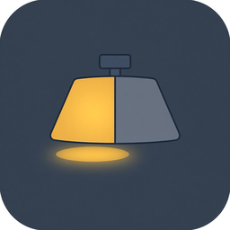
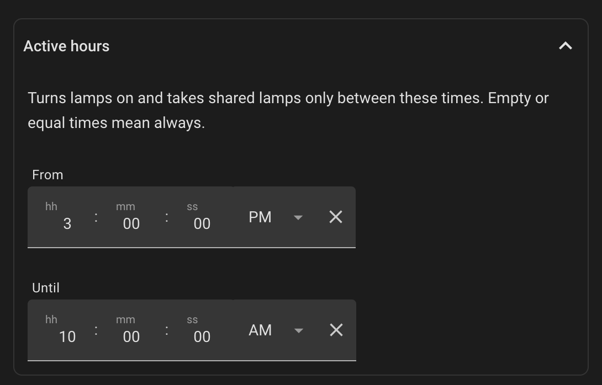

# Adaptive Light

Adaptive Light is a Home Assistant integration. One config entry is one zone: it turns that zone’s lamps on and off from presence, with an optional lux window. It calls Adaptive Lighting only when Hold color or Hold brightness is on.

## What a zone does

A zone turns its lamps on when someone is present and turns them off when presence is gone. With a lux threshold, the decision uses a weighted average over a window, not the instant reading. Newer samples weigh more. An average below the threshold turns the lamps on. An average above it turns them off. A falling average does not turn them off. Threshold 0 follows presence only.

One integration entry is one zone, with its own lamps and sensors. Another room is another entry.

## One living room

Several zones share the ceiling lamps. The living-room zone keeps them while the room is in use. A desk or fridge zone with a higher priority takes a lamp while someone is there, then the living-room zone gets it back. Color and brightness stay with Adaptive Lighting unless that zone holds them.

## Install with HACS

1. Use the button above, or add `https://github.com/menikoDev/adaptive-light-hacs` as an Integration repository.
2. Download Adaptive Light and restart Home Assistant.
3. Settings → Devices & services → Add integration → Adaptive Light.

Without HACS, copy `custom_components/adaptive_light` into `<config>/custom_components/` and restart Home Assistant.

## Zone

### Presence

One or more `binary_sensor` entities. The zone is occupied when any of them is on. When every sensor has been off for longer than the timeout, the lamps turn off.

### Lux window

An optional lux sensor. The threshold is in lux. The window is in minutes and defaults to 10. Threshold 0 skips this check.

### Priority

An integer, 0 by default. The higher number takes a shared lamp. Only the owning zone calls that lamp.

Name, lamps, presence, the lux window, and priority. The color bar and the unlabeled hold switch at the bottom of this shot are from an older form. The current form has one Color group: red, green, blue, a Kelvin slider, and one Hold color switch.

### Color and brightness

The Color group is red, green, and blue from 0 to 255, plus a Kelvin slider. Hold color sends RGB when any of the three boxes is filled, and Kelvin otherwise.

The Brightness group is a level from 0 to 255. Hold brightness sends that level.

An unchecked box sends nothing.

### Active hours

Two times, From and Until. The Use these hours switch is off by default, so the zone stays active even when the times are filled. On uses the window, including one that crosses midnight, such as 15:00 to 10:00. Outside that window the zone does not turn lamps on and does not take shared lamps. Empty or equal times also mean always active.

From and Until can cross midnight. This shot does not include the Use these hours switch. That switch is in the current group and defaults to off.

### Night mode

A separate window. It does not replace active hours. Inside it, lamps turn off after the still period with no movement and turn on again when movement returns. A presence sensor that merely stays on does not count as movement.

## Adaptive Lighting

Adaptive Lighting is called only when Hold color or Hold brightness is on. The call marks the part the zone sent, so Adaptive Lighting does not change it. Empty red, green, blue, and Kelvin with Hold color on still does not call Adaptive Lighting. With both boxes off, the lamp call is only `light.turn_on` with `entity_id`.
