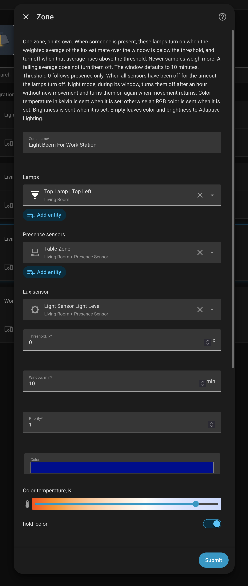
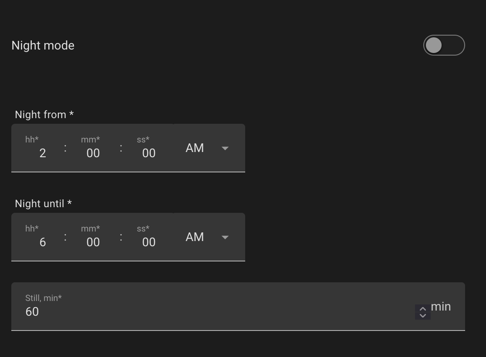

# Adaptive Light

One living room has one lux sensor and several places that need the light for different reasons.

A person at the desk, someone at the fridge, and the room itself can all want the same ceiling lamp. They should not fight over it.

Adaptive Lighting already paints the color through the day. This integration decides who owns the lamp.

You walk to the fridge. The fridge zone has a higher priority, so it takes the lamp while you are there. Color and brightness stay with Adaptive Lighting unless that zone holds them.

You leave. The fridge zone lets the lamp go. The living-room zone gets it back.

The desk works the same way. While you are there, the desk zone owns the lamp. When you leave, the room has it again.

## Install with HACS

1. Use the button above, or add `https://github.com/menikoDev/adaptive-light-hacs` as an Integration repository.
2. Download Adaptive Light and restart Home Assistant.
3. Settings → Devices & services → Add integration → Adaptive Light.

Without HACS, copy `custom_components/adaptive_light` into `<config>/custom_components/` and restart Home Assistant.

## Zone

One config entry is one zone, with its own lamps and sensors. Another place is another entry.

### Presence

One or more `binary_sensor` entities. The zone is occupied when any of them is on. When every sensor has been off for longer than the timeout, the lamps turn off.

### Switched off by hand

Turn one lamp off while the zone is holding it on. The zone remembers that lamp and leaves it off. Presence coming back does not turn it on. A lux average falling below the threshold does not turn it on. The other lamps in the zone still follow presence and lux.

Turn that lamp on by hand and the mark clears. Turn the zone enable switch off, then on, and the mark clears too. Leaving and coming back does not.

### Lux window

An optional lux sensor. The threshold is in lux. The window is in minutes and defaults to 10. The decision uses a weighted average over that window, not the instant reading. Newer samples weigh more. An average below the threshold turns the lamps on. An average above it turns them off. A falling average does not turn them off. Threshold 0 skips this check and follows presence only.

### Priority

An integer, 0 by default. The higher number takes a shared lamp. Only the owning zone calls that lamp.

Name, lamps, presence, the lux window, and priority. The color bar and the unlabeled hold switch at the bottom of this shot are from an older form. The current form has one Color group: red, green, blue, a Kelvin slider, and one Hold color switch.

### Color and brightness

The Color group is red, green, and blue from 0 to 255, plus a Kelvin slider. Hold color sends RGB when any of the three boxes is filled, and Kelvin otherwise.

The Brightness group is a level from 0 to 255. Hold brightness sends that level.

An unchecked box sends nothing.

### Active hours

The Use these hours switch is off by default, so the zone stays active. On, the zone turns lamps on and takes shared lamps when the current time falls in any window. Each window is a numbered group, Group 1 and Group 2, with From and To time fields, the same kind as Night from and Night until. Fill the next empty group to add a window. Leave both times empty to skip that group. Saved groups are ordered by start time, so an overnight window such as 22:00 to 06:00 follows its start. No groups filled means always active. Off ignores every group. A zone saved as `09:00-12:00` still loads.

The shot is an older form, one From and Until that cross midnight. The current form is the switch plus Group 1, Group 2, and so on.

### Entry delay

Lamps turn on only after a presence sensor stays on. The Entry delay group has Day, s (default 2) and Night, s (default 5). Use a night delay is off by default, the same kind of switch as Use these hours, so night uses the day delay until that switch is on. On, the night delay applies inside the night window. A shorter spike does not turn the lamps on. A change to off or clear does not turn them on. Zero is immediate.

### Night mode

A separate window. It does not replace active hours. The switch defaults off, and off means the times do nothing. On, the from/to pair is one overnight window, 02:00 to 06:00 unless you change it. Inside that window the lamps turn off after the still period when no presence sensor changes state, in this zone or in any other zone. A sensor that stays on does not count. Any later state change starts the period again and turns the lamps back on.

## Adaptive Lighting

Adaptive Lighting is called only when Hold color or Hold brightness is on. The call marks the part the zone sent, so Adaptive Lighting does not change it. Empty red, green, blue, and Kelvin with Hold color on still does not call Adaptive Lighting. With both boxes off, the lamp call is only `light.turn_on` with `entity_id`.
